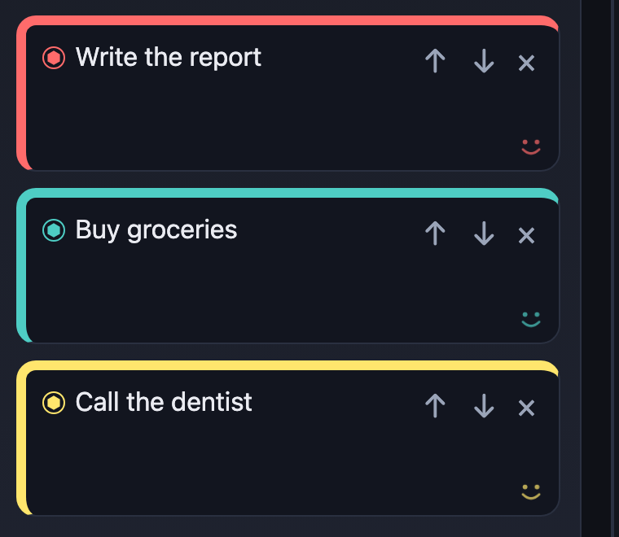

# Spike: doodle card faces (issue #17)

Prototype: opt-in with `/?faces=1` (read once at module load in `src/cardFacesFlag.ts`; component in `src/components/CardFace.tsx`). Without the flag nothing renders and `TaskCard` is unchanged apart from a constant-false conditional. The face is an inline `<svg>` (two eyes, one smile) added as the last child of `TaskCardChrome`, styled by `src/styles/features/card-face.css`.

## Recommendation

Build it, as inline SVG + CSS, behind a user setting (default off). Video and Lottie are not worth it for a face on every card: SVG costs about 0.5 KB gzipped of CSS plus about 8 DOM nodes per card, adds no dependency, and themes for free. The one real cost is main-thread style recalculation from per-element animation (measured below, roughly 14-18% of one core with 50 animated cards), so the follow-ups below should add mitigations (pause when off-screen or during drag, fewer animated elements) before enabling it by default. Drag, click-through, reduced motion and axe all pass with the layer on.

## 1. Format: inline SVG+CSS vs WebM vs Lottie

| | Inline SVG + CSS | WebM loop | Lottie |
|---|---|---|---|
| Per-card cost | 1 `<svg>`, 3 shapes (~8 nodes incl. text-less children); no network | One `<video>` element and decoder per card; browsers cap concurrent decoders | One lottie player instance (canvas/SVG) per card, JS-driven per frame |
| Bundle | ~2 KB source for component + CSS (CSS 510 B gzipped) | Asset per variant (typically tens of KB each, not measured); no JS | `lottie-web` is a runtime dependency (hundreds of KB; not measured here, not installed) |
| Theming | `currentColor` / CSS variables | Baked colours; separate light/dark assets, no per-card accent | Possible via JSON edits, awkward |
| Reduced motion | One media query | JS to pause | JS to pause |

Only the SVG variant was built and measured. The WebM and Lottie columns are reasoning from how those formats work, not measurements; I did not install `lottie-web` or encode any video.

### Measured: 50 cards, SVG+CSS

Method: headless Chromium (Playwright, desktop viewport 1280x900), dev server (Vite, unminified), 50 backlog tasks added via the UI, idle board, 1 s settle, then a 5 s window. Frame timing from `requestAnimationFrame` deltas; CPU from CDP `Performance.getMetrics` deltas (`TaskDuration`, `ScriptDuration`, `LayoutDuration`, `RecalcStyleDuration`) over the window. Two runs each, alternating off/on. Script was a throwaway outside the repo.

| | faces off | faces on (50) |
|---|---|---|
| Frames in 5 s | 302 | 301 |
| Mean / p95 / max frame interval | 16.6 / 16.7 / 16.8 ms | 16.7 / 16.7-16.8 / 16.8 ms |
| Main-thread task time per 5 s | 63 ms (both runs) | 721-887 ms |
| Style recalc per 5 s | 0 ms | 134-176 ms |
| Layout per 5 s | 0 ms | 17-26 ms |
| DOM nodes | 1285 | 1471 (+186, about 3.7 per card) |

Reading: the frame rate holds at 60 fps with 50 animated faces, but the main thread is busy about 0.15-0.18 s per second versus about 0.013 s without faces. The cause is that the eyes and smile animate `transform` on SVG child elements, which Chrome does not composite, so every animation tick runs style recalc (and some layout) on the main thread. This is on an idle board, headless, on a dev build, on one machine; a throttled laptop on battery or a board with many more cards would feel it more. I did not test CPU throttling, other browsers, Safari, or real GPU compositing, and did not profile during a drag.

Likely mitigations to try in implementation (not tried here): animate one element per face (e.g. a blink on a single group) instead of three; lengthen the cycle and stagger via `animation-delay` so ticks are spread; `animation-play-state: paused` for off-screen cards (IntersectionObserver) and while any drag is active; or `content-visibility: auto` on cards.

## 2. Pointer model

Current DnD: dnd-kit `PointerSensor` with `activationConstraint: { distance: 6 }` and the listeners spread on the whole card; the title, reorder and remove buttons stop `pointerdown` propagation. The face is a sibling of the grid with `pointer-events: none`, so hit-testing skips it and events land on whatever is underneath (the card itself or a button). Nothing in the DnD wiring needed to change.

Verified in `e2e/card-faces.spec.ts` (all pass):
- drag backlog -> schedule and back with faces on;
- a drag started with the pointer directly over the face works (the event reaches the card);
- the move up/down button and the title button (opens the detail dialog) still work with faces on;
- the face element has computed `pointer-events: none`.

Not covered: touch input (the card already sets `touch-action: none`) and the keyboard drag sensor (a documented existing limitation, unchanged).

## 3. Reduced motion

`@media (prefers-reduced-motion: reduce)` sets `animation: none` on the eyes and smile, leaving a static open-eyed smile. The e2e test uses `page.emulateMedia({ reducedMotion: 'reduce' })` and asserts the computed `animation-name` is `none` for the eyes and smile (and, in the non-reduced test, that it is `ph-face-blink`).

## 4. Theming

Every stroke and fill is `currentColor`; `.ph-card__face` sets `color: var(--ph-face-accent, var(--ph-muted))` and the component sets `--ph-face-accent` inline to the card's accent ring colour, so the face matches each card's colour (see screenshot) with one asset. The app currently ships a single dark theme, so a real light/dark switch was not exercised; with variables nothing per-theme would be needed. Contrast: the face is decorative at 0.7 opacity and carries no information, so it is exempt from text contrast requirements, but axe was not asked to judge it (aria-hidden).

## 5. Accessibility

The SVG has `aria-hidden="true"` and `focusable="false"`; it is not in the tab order. The axe scan (WCAG 2.0/2.1 A and AA, same tags as `e2e/a11y.spec.ts`) over a board with one backlog card and one scheduled card, faces on, returns zero violations. Animation is a tiny, non-flashing, looping decoration; with reduced motion it stops. WCAG 2.2.2 (pause/stop/hide for motion over 5 s) technically wants a user control for non-essential looping motion that cannot be turned off; the reduced-motion query covers OS-level opt-out, but an in-app toggle is recommended (see follow-ups).

## 6. Follow-up issues (if building)

1. **Setting: "Card faces" toggle** - persisted user preference (default off) replacing the `?faces=1` flag; covers the WCAG 2.2.2 in-app control.
2. **Cut the main-thread cost of face animation** - benchmark with CPU throttling, reduce to one animated element per face, stagger timing, and pause off-screen cards and during drags.
3. **Face design pass** - final art (expressions, size per card variant and lane card height, placement that never overlaps the title or the actions, a short-card/very short lane fallback).
4. **Drag overlay and detail panel parity** - decide whether the drag overlay card and task detail show a face, and keep them static while dragging.
5. **State-driven expressions (optional)** - e.g. a different face for scheduled/overdue/done tasks; needs product input.
6. **e2e and a11y regression coverage** - fold `e2e/card-faces.spec.ts` into the normal suite with the real setting rather than the query flag, and add a light-theme check if a light theme ships.

## What I could not measure

- WebM and Lottie cost (no assets or `lottie-web` installed): the comparison for those is qualitative.
- CPU under throttling, on other browsers or devices, or during a drag.
- Production-build timings (measured on the Vite dev server).
- A real light theme (none exists).
- Screen reader behaviour beyond axe.
